<p align="center">
  <a href="https://ruvelo.github.io/wp-feedback/">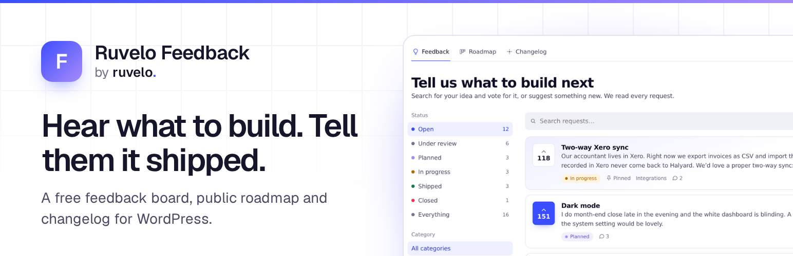</a>
</p>

<p align="center">
  <a href="https://playground.wordpress.net/?blueprint-url=https://raw.githubusercontent.com/Ruvelo/wp-feedback/main/blueprint.json"><strong>Try it in Playground</strong></a> &nbsp;&nbsp;&nbsp;
  <a href="https://ruvelo.github.io/wp-feedback/"><strong>Website</strong></a> &nbsp;&nbsp;&nbsp;
  <a href="#for-developers"><strong>Developer guide</strong></a> &nbsp;&nbsp;&nbsp;
  <a href="CHANGELOG.md"><strong>Changelog</strong></a>
</p>

<p align="center">
  <a href="https://github.com/Ruvelo/wp-feedback/actions/workflows/tests.yml"></a>
  
  
  
  
  <a href="LICENSE"></a>
</p>

# Ruvelo Feedback

**A free feedback board, public roadmap and changelog for WordPress.** Your users ask for things and vote, you plan and build, and when it ships everyone who asked is told: by email, and in a "What's new" bell on your site. The loop that Canny, Featurebase and Beamer sell as a subscription, as one plugin that keeps everything in your own WordPress.

```
wp plugin install ruvelo-feedback --activate
```

Then Feedback → Settings → **Create the feedback pages**. Or click around [Halyard's portal in WordPress Playground](https://playground.wordpress.net/?blueprint-url=https://raw.githubusercontent.com/Ruvelo/wp-feedback/main/blueprint.json) first: it runs in your browser.

## A quick tour

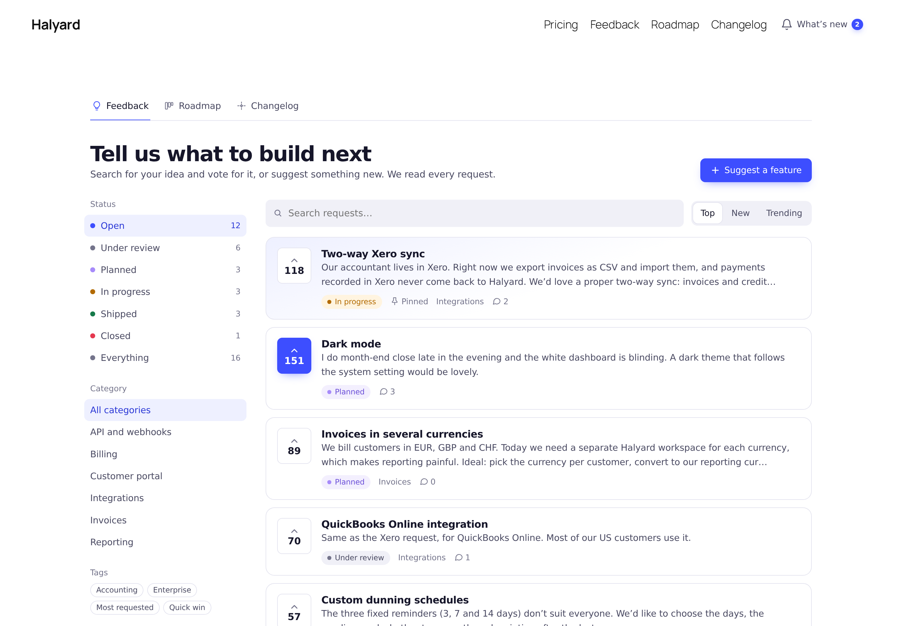

**A board people actually use.** Requests with one-click votes, filtered by status, category and tag, searchable, sorted by top, new or trending. Pinned requests stay on top. Anyone can read; posting and voting need an account, or a confirmed email address if you allow guests.

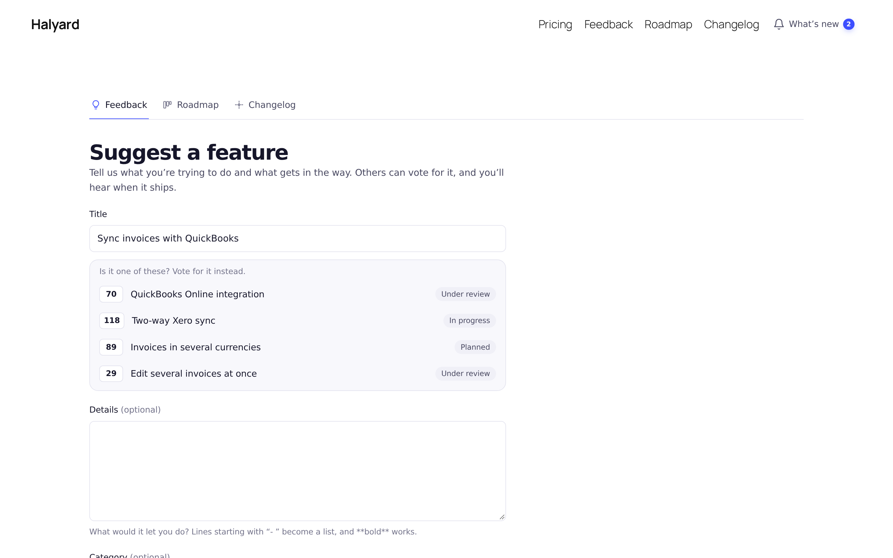

**Fewer duplicates.** While someone types a title, similar requests appear with their votes. Without JavaScript the form shows them before posting. When duplicates slip through, merge them: votes and comments carry over, nobody is counted twice, and the old address redirects.

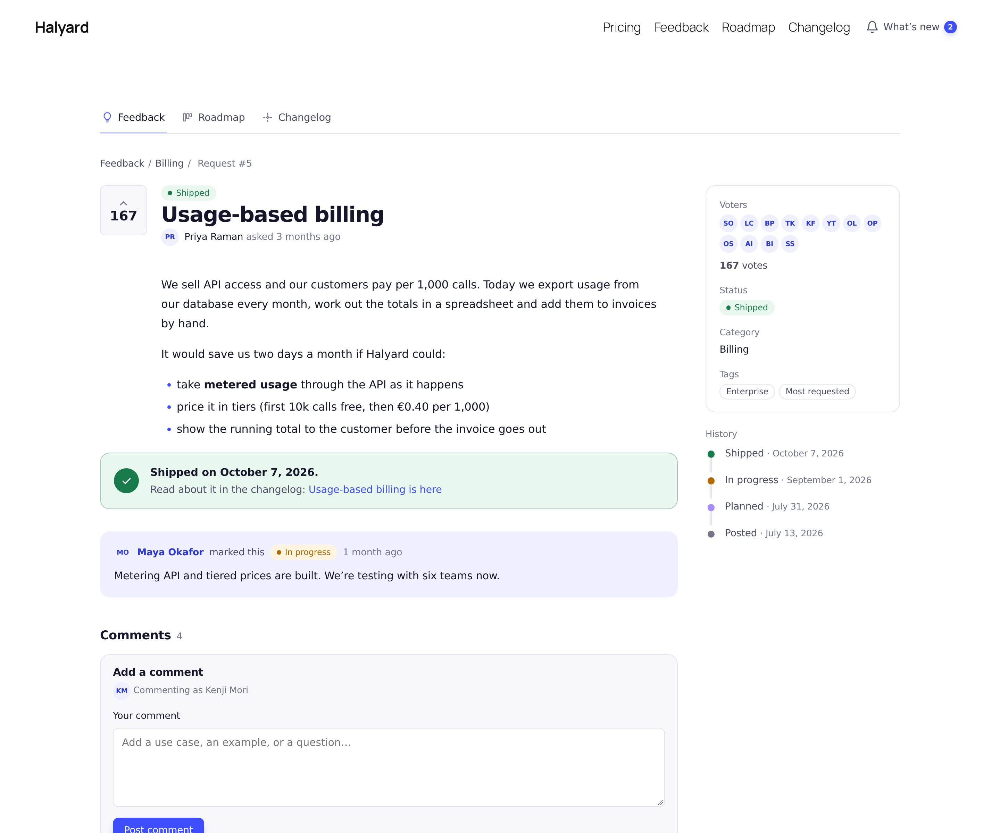

**Every request tells its story.** Status history, the team's public notes, core WordPress comments (staff get a "Team" badge) and a link to the changelog entry it shipped in.

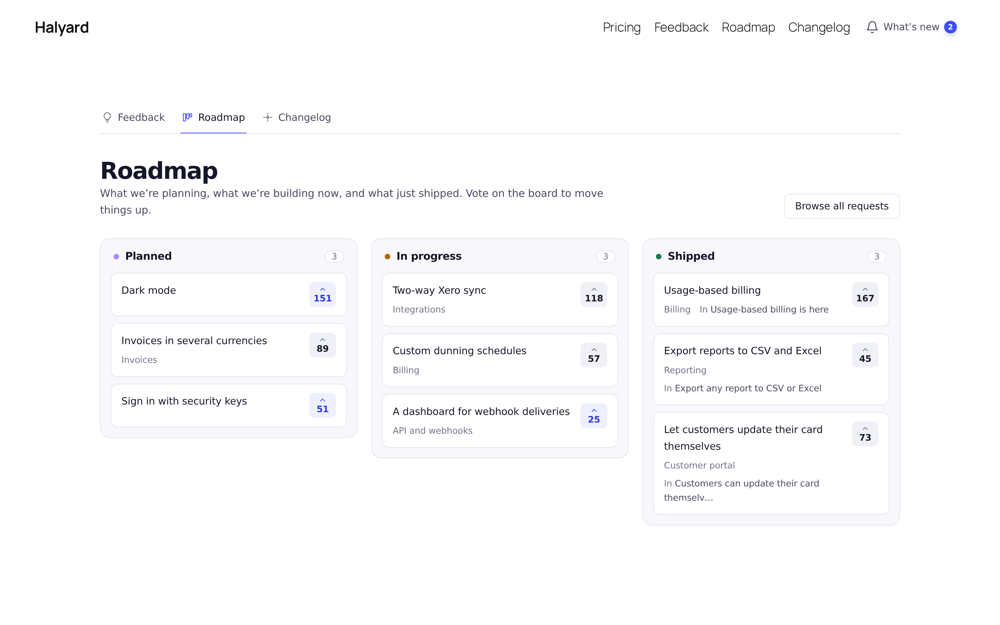

**A public roadmap** of what's planned, in progress and shipped, straight from the board.

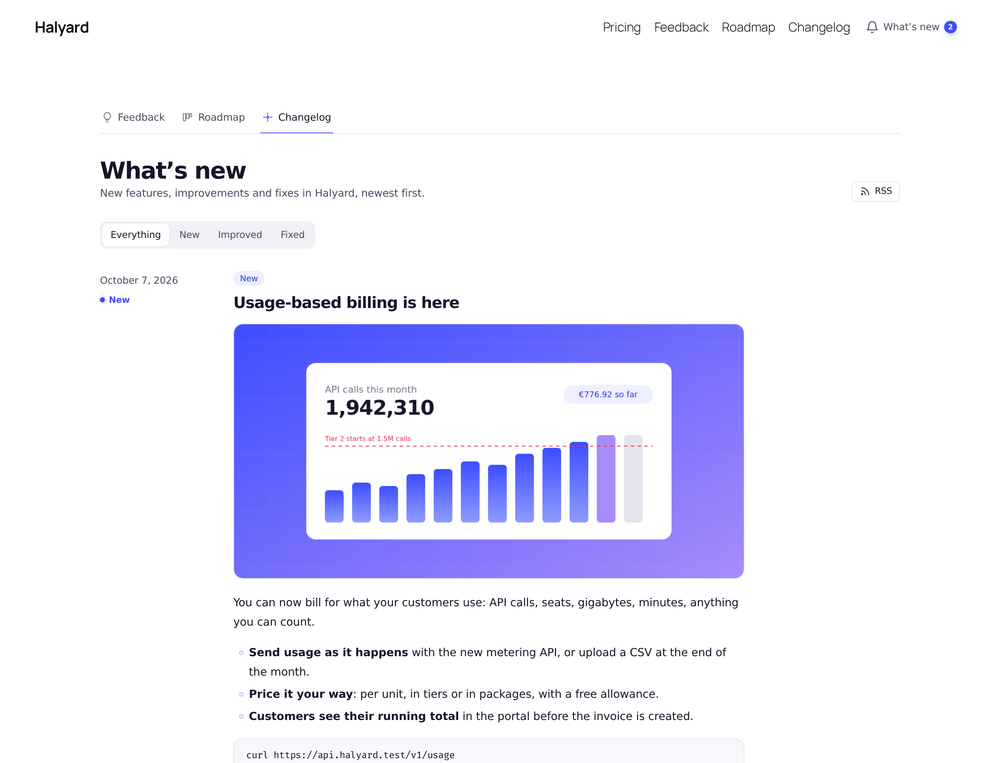

**A changelog with RSS.** Entries are ordinary posts with labels, featured images and the requests they answer. Publish one and its requests are marked Shipped.

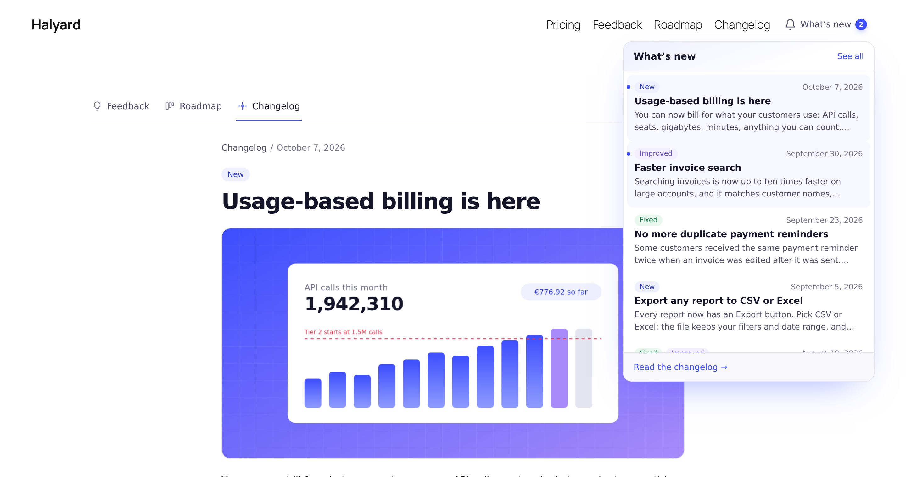

**"What's new" on your site.** A block for your header: how many updates each visitor hasn't seen, and the latest in a dropdown. It's a `<details>` element, so it opens without JavaScript too.

<table>
  <tr>
    <td width="50%">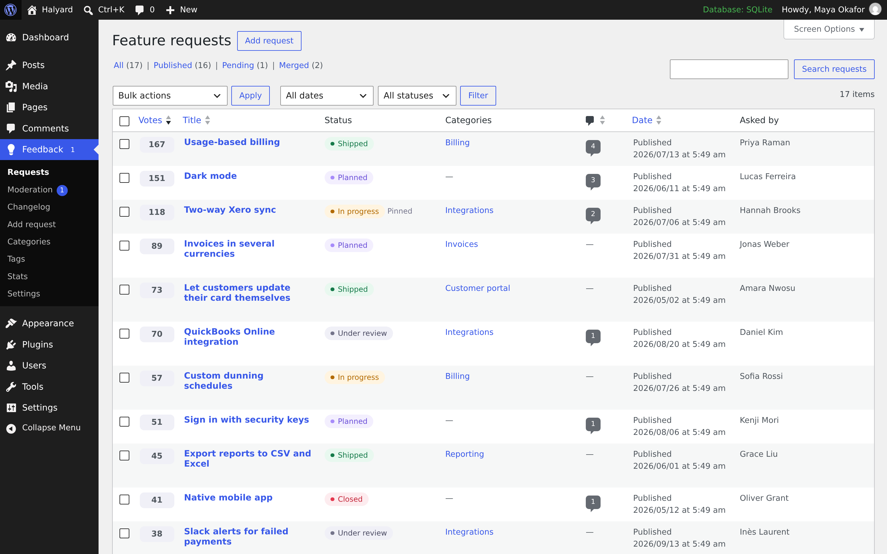</td>
    <td width="50%">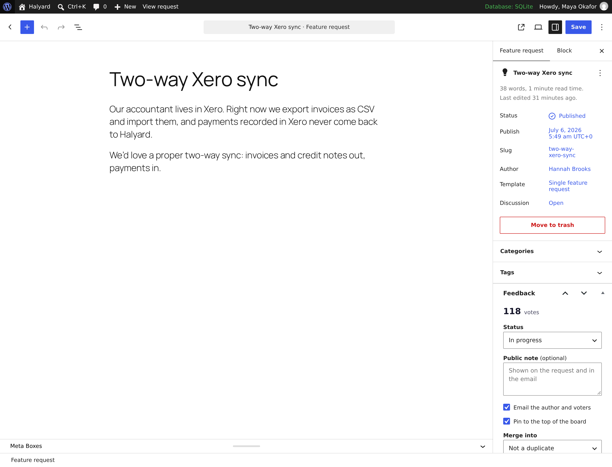</td>
  </tr>
  <tr>
    <td><strong>The admin you know</strong>: votes and status columns, bulk status changes, a moderation queue.</td>
    <td><strong>A Feedback panel</strong> in the editor: status with a public note, pin, merge.</td>
  </tr>
  <tr>
    <td width="50%">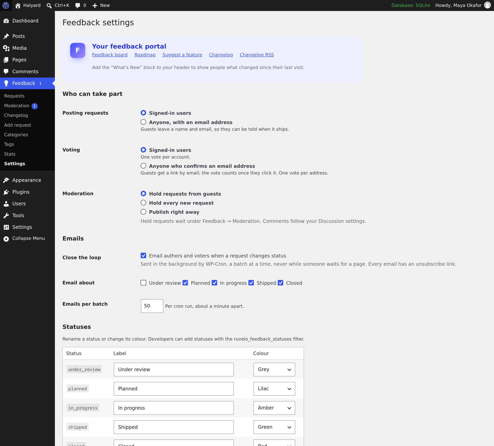</td>
    <td width="50%">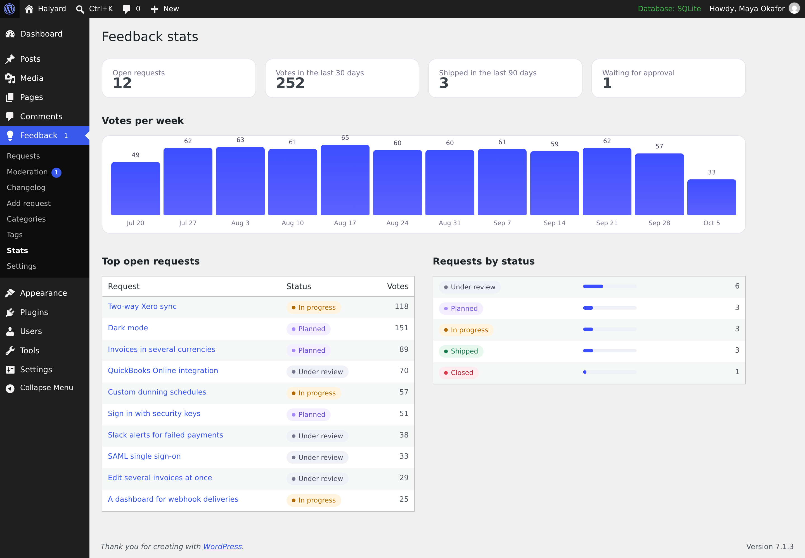</td>
  </tr>
  <tr>
    <td><strong>Settings</strong> and the one-click "Create the feedback pages".</td>
    <td><strong>Simple stats</strong>: votes per week, top requests, requests by status.</td>
  </tr>
  <tr>
    <td width="50%">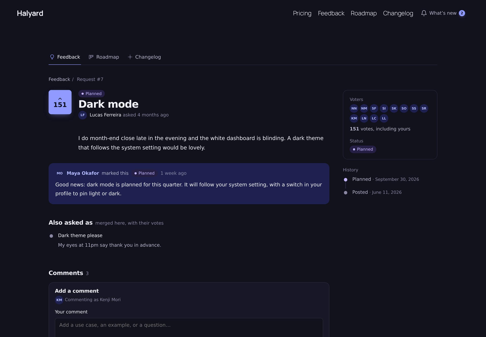</td>
    <td width="50%">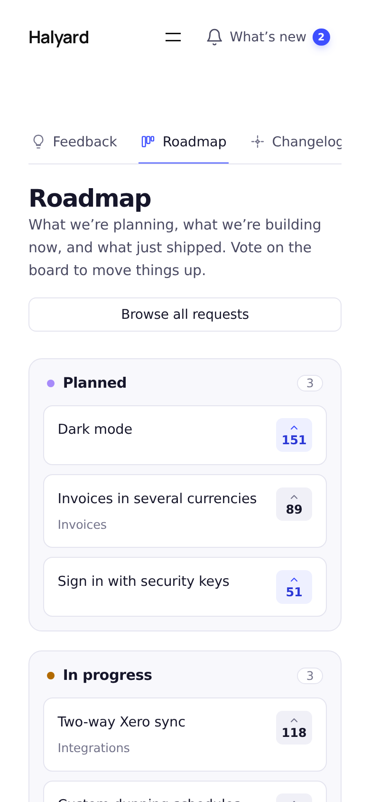</td>
  </tr>
  <tr>
    <td><strong>Light, dark</strong> or each visitor's system setting.</td>
    <td><strong>Mobile first</strong>, down to 360px.</td>
  </tr>
</table>

## Features

- **Requests** are a custom post type with categories and tags, core comments and revisions. Statuses: Under review, Planned, In progress, Shipped and Closed, with your own labels and colours (or more, through a filter). Shipped and closed requests stop taking votes.
- **Votes** live in their own table with a unique `(request, voter)` index: one vote per person, even when two clicks race. Guests can vote by confirming an email address (off by default).
- **Posting** from a front-end form, by signed-in users by default; optionally guests with a name and email, held for moderation.
- **Merging** duplicates: votes carry over without double counting, comments move, the duplicate's author becomes a voter, and its page redirects with a 301.
- **Roadmap** columns and a **changelog** post type with labels (New, Improved, Fixed), linked requests, list and single templates, and the core RSS feed.
- **Closing the loop**: status changes and shipped changelog entries queue emails to the author and every voter, sent by WP-Cron in batches, with one-click unsubscribe (per request or everything). A hook for every recipient, so another plugin can deliver instead.
- **Five blocks**, rendered in PHP: Feedback Board, Roadmap, Changelog, What's New and Submit Request. "Ruvelo", "Match theme" and "Compact" block styles, CSS variables, and shortcodes for classic themes.
- **Block templates** for single requests, changelog entries and the changelog archive, a wide "Feedback portal" page template, and patterns. Classic themes get the same views inside their header and footer.
- **Admin**: votes and status columns, a status filter, bulk status changes, a moderation queue with a count, the Feedback panel, settings and stats.
- **Developer API**: REST (`ruvelo-feedback/v1`), WP-CLI, Abilities API, actions and filters, overridable templates, settings in code.
- **Privacy**: personal data export and erasure, a privacy policy paragraph, and no remote requests.
- **Safe by default**: nonces and capability checks on every write, `$wpdb->prepare()` everywhere, escaped output, rate limits and a honeypot on public forms.

## Our promises

- **No nags, no upsells, no "pro" version.** No admin notices outside the plugin's own screens, no review requests, no ads, no redirect on activation.
- **No tracking and no remote requests.** Nothing phones home; no fonts, scripts, images or banners are loaded from anywhere else. The only emails sent are the ones you turn on.
- **Updates only from WordPress.org and Composer**, through WordPress's own updater. Ruvelo will never sell this plugin, its WordPress.org account or its users.
- **A clean uninstall.** Scheduled emails are always cleared. Content stays unless you tick "Also delete every request, vote, changelog entry and setting".
- **Accessible**: aiming at WCAG 2.2 AA, working without JavaScript, respecting reduced motion and dark mode.

## Requirements

- WordPress 7.0 or later (tested up to 7.1)
- PHP 8.2 or later
- MySQL or MariaDB, or SQLite through the official integration plugin

## Getting started

**1. Install** from Plugins → Add New, with WP-CLI as above, or with Composer (`composer require ruvelo/wp-feedback`, installed by `composer/installers` as a WordPress plugin).

**2. Create the pages.** Feedback → Settings → **Create the feedback pages** (or `wp ruvelo-feedback setup`) creates:

| Page | Address | Block |
|---|---|---|
| Feedback | `/feedback/` | Feedback Board |
| Roadmap | `/feedback/roadmap/` | Roadmap |
| Suggest a feature | `/feedback/new/` | Submit Request |
| (the changelog archive) | `/feedback/changelog/` | Changelog, through the archive template |

Requests live at `/feedback/requests/<slug>/` and entries at `/feedback/changelog/<slug>/`. Change the bases with the `ruvelo_feedback_request_slug` and `ruvelo_feedback_changelog_slug` filters.

**3. Add "What's new" to your header**: in the Site Editor, edit the Header template part and insert the What's New block (or the "Header link with What's new" pattern).

**4. Decide who takes part** in Feedback → Settings: posting and voting (signed-in users, or anyone with an email), moderation, which statuses send email, the status labels and colours, and the colour scheme.

## Who can do what

| Capability or setting | Default | |
|---|---|---|
| `ruvelo_manage_feedback` | Administrators and editors | Manage requests and the changelog, change statuses, merge, pin, approve. Filter `ruvelo_feedback_manager_roles` before activation, or grant it to any role |
| Posting (`post`) | Signed-in users | `anyone`: guests leave a name and an email |
| Voting (`vote`) | Signed-in users | `anyone`: guests confirm an email address first |
| Moderation (`moderation`) | `guests` | `all` or `none` |
| Comments | Your Discussion settings | Core comments, moderated the WordPress way |

## Making it look like your site

Every colour, radius and font is a CSS variable on `.ruvelo-fb`:

```css
.ruvelo-fb { --ruvelo-feedback-accent: #0f766e; --ruvelo-feedback-accent-soft: #e6f4f1; --ruvelo-feedback-radius: 4px; --ruvelo-feedback-sans: Inter, sans-serif; }
```

Pick the **Match theme** block style to inherit your theme's fonts and accent colour, or **Compact** for a denser board and changelog. To change the markup, copy a file from the plugin's `templates/` to `your-theme/ruvelo-feedback/` (for example `ruvelo-feedback/parts/card.php`), or use the `ruvelo_feedback_template` filter.

## For developers

### Data

| What | Where |
|---|---|
| Requests | Post type `ruvelo_request`; meta `_ruvelo_status`, `_ruvelo_votes`, `_ruvelo_pinned`, `_ruvelo_history`, `_ruvelo_entry`, `_ruvelo_merged_into`; status `ruvelo_merged` for merged duplicates |
| Categories, tags | Taxonomies `ruvelo_request_category`, `ruvelo_request_tag` |
| Changelog | Post type `ruvelo_entry`; meta `_ruvelo_requests`; taxonomy `ruvelo_entry_label` (`new`, `improved`, `fixed`) |
| Votes | Table `{prefix}ruvelo_feedback_votes`, unique on `(request_id, voter)` where voter is `u:<user id>` or `e:<sha256 of email>` |
| Email queue | Table `{prefix}ruvelo_feedback_outbox`, one row per status change, worked through by WP-Cron |
| Settings | Option `ruvelo_feedback_settings` (filter `ruvelo_feedback_settings` to define them in code) |

### PHP API

`Ruvelo\WP\Feedback\Requests` is the one write path: forms, REST, WP-CLI, abilities and the admin all use it, so counts stay right and hooks fire. It doesn't check capabilities; callers do.

```php
use Ruvelo\WP\Feedback\Changelog;
use Ruvelo\WP\Feedback\Requests;

$id = Requests::create(['title' => 'Dark mode', 'body' => 'For **late** nights', 'category' => 'billing'], $user_id);
Requests::vote($id, $other_user_id);                 // true when added, false if already there
Requests::unvote($id, $other_user_id);
Requests::changeStatus($id, 'planned', 'Starting in March.', get_current_user_id());
Requests::merge($duplicate_id, $id);                 // votes moved
Requests::pin($id);
Requests::approve($id);

Requests::board(['status' => 'open', 'sort' => 'trending']);
Requests::similar('dark theme');
Requests::roadmap();

$entry = Changelog::create('Dark mode is here', $html, ['new'], [$id]);   // ships $id
Changelog::unreadCount($user_id);
```

### Actions

| Action | Arguments | When |
|---|---|---|
| `ruvelo_feedback_request_created` | `$id, $user_id` | A request is posted (check the post status: `pending` when held) |
| `ruvelo_feedback_request_approved` | `$id` | A held request is published |
| `ruvelo_feedback_voted` | `$id, $voter, $added` | A vote is added or taken back |
| `ruvelo_feedback_status_changed` | `$id, $from, $to, $note, $by, $entry_id` | Right after a status change (emails are only queued) |
| `ruvelo_feedback_notification` | `$recipient, $message` | For every author and voter told about a change, from WP-Cron, whether or not they get an email. `$message` has `subject`, `title`, `body`, `url`, `request_id`, `status`, `event` and `unsubscribe` |
| `ruvelo_feedback_requests_merged` | `$duplicate, $into, $moved, $by` | A duplicate was merged |
| `ruvelo_feedback_request_pinned` | `$id, $pinned` | Pinned or unpinned |
| `ruvelo_feedback_request_deleted` | `$id` | A request was deleted, with its votes |
| `ruvelo_feedback_entry_published` | `$entry_id` | A changelog entry went live (once) |
| `ruvelo_feedback_unsubscribed` | `$email, $request_id, $scope` | Someone unsubscribed (`request` or `all`) |
| `ruvelo_feedback_pages_created` | `$ids` | The portal pages were created |

### Filters

| Filter | Default | |
|---|---|---|
| `ruvelo_feedback_settings` | Saved settings | Define settings in code |
| `ruvelo_feedback_statuses` | Five statuses | `key => [label, color]`; color is a tone (`accent`, `lilac`, `success`, `warning`, `danger`, `neutral`) or `#hex` |
| `ruvelo_feedback_open_statuses` | under review, planned, in progress | The board's default filter |
| `ruvelo_feedback_locked_statuses` | shipped, closed | No new votes |
| `ruvelo_feedback_roadmap_statuses` | planned, in progress, shipped | The roadmap's columns |
| `ruvelo_feedback_labels` | New, Improved, Fixed | Default changelog labels and colours |
| `ruvelo_feedback_can_post`, `ruvelo_feedback_can_vote` | From the settings | Decide per visitor |
| `ruvelo_feedback_manager_roles` | administrator, editor | Roles given the capability on activation |
| `ruvelo_feedback_send_email` | `true` | Return false to deliver some other way |
| `ruvelo_feedback_message` | | Change a notification before it's sent |
| `ruvelo_feedback_rate_limit` | 5 requests, 60 votes, 5 guest votes per minute | `($limit, $action)`; 0 turns one off |
| `ruvelo_feedback_board_query` | | The board's `WP_Query` arguments |
| `ruvelo_feedback_trending_days` | 14 | What "trending" counts |
| `ruvelo_feedback_fresh_days` | 30 | What counts as new for someone who never looked |
| `ruvelo_feedback_request_slug`, `ruvelo_feedback_changelog_slug` | `feedback/requests`, `feedback/changelog` | URL bases |
| `ruvelo_feedback_team_label` | "Team" | The badge on staff comments |
| `ruvelo_feedback_template` | | `($file, $template, $view)`: use another template file |
| `ruvelo_feedback_uninstall_delete_data` | The setting | Decide in code whether uninstalling deletes content |

### REST API

Namespace `ruvelo-feedback/v1`. Reads are public and only show what the caller may see. Writes use cookie authentication with the `wp_rest` nonce, or application passwords.

| Request | Who | Does |
|---|---|---|
| `GET /requests?status=&category=&tag=&search=&sort=&page=&per_page=` | Anyone | The board (`X-WP-Total` and `X-WP-TotalPages` headers) |
| `GET /requests/{id}` | Anyone (pending: author and managers) | One request with `history` and `can` |
| `GET /requests/similar?q=` | Anyone | Similar requests |
| `POST /requests` | Signed in, or anyone when guests may post | `{title, body?, category?, name?, email?}` |
| `POST` / `DELETE /requests/{id}/vote` | Voters | Returns `voted` and `votes` |
| `POST /requests/{id}/status` | Managers | `{status, note?, notify?}` |
| `POST /requests/{id}/merge` | Managers | `{into}` |
| `POST /requests/{id}/pin` | Managers | `{pinned}` |
| `POST /requests/{id}/approve` | Managers | Publish a held request |
| `GET /roadmap` | Anyone | Columns of requests |
| `GET /statuses` | Anyone | Keys, labels, colours, open and locked |
| `GET /changelog?label=&page=&per_page=` | Anyone | Published entries with labels and requests |
| `GET /changelog/unread` | Anyone | `unread` for the current visitor |
| `POST /changelog/seen` | Anyone | Mark the changelog as seen |

Requests and entries are also in core REST (`wp/v2/ruvelo-requests`, `wp/v2/ruvelo-changelog`), writable by managers only. The plugin's meta is read-only there: status changes go through the routes above, so voters are told.

Errors: `401` for guests, `403` when not allowed, `404` for what the caller can't see, `409` when voting is closed, `422` for invalid input, `429` when rate limited.

### WP-CLI

| Command | |
|---|---|
| `wp ruvelo-feedback request list [--status=] [--category=] [--search=] [--sort=] [--format=]` | List requests |
| `wp ruvelo-feedback request get <id>` | One request with its history |
| `wp ruvelo-feedback request create <title> [--body=] [--user=] [--category=] [--status=] [--porcelain]` | Post a request |
| `wp ruvelo-feedback request status <id> <status> [--note=] [--no-notify] [--by=]` | Change status (emails queued) |
| `wp ruvelo-feedback request merge <id> --into=<id>` | Merge a duplicate |
| `wp ruvelo-feedback request pin <id> [--off]` | Pin or unpin |
| `wp ruvelo-feedback request approve <id>...` | Approve held requests |
| `wp ruvelo-feedback request vote <id> --user=<user>` | Vote for someone |
| `wp ruvelo-feedback changelog list` | List entries |
| `wp ruvelo-feedback changelog create <title> [--content=] [--labels=] [--requests=] [--draft]` | Write an entry |
| `wp ruvelo-feedback changelog publish <id> [--requests=]` | Publish it and ship its requests |
| `wp ruvelo-feedback notifications status` / `run [--batch=]` | See or send waiting emails |
| `wp ruvelo-feedback setup` | Create the portal pages |
| `wp ruvelo-feedback stats` | Open, pending, shipped and vote counts |
| `wp ruvelo-feedback demo --yes` | Seed Halyard's demo portal (for trying it out) |

### Abilities (AI agents)

Registered with the WordPress Abilities API in the `ruvelo-feedback` category, shown in REST and to the MCP adapter when it's installed:

| Ability | Permission |
|---|---|
| `ruvelo-feedback/list-requests` | Anyone (read-only) |
| `ruvelo-feedback/search-requests` | Anyone (read-only) |
| `ruvelo-feedback/get-request` | Anyone (read-only) |
| `ruvelo-feedback/get-roadmap` | Anyone (read-only) |
| `ruvelo-feedback/get-changelog` | Anyone (read-only) |
| `ruvelo-feedback/submit-request` | A signed-in user allowed to post |
| `ruvelo-feedback/change-status` | `ruvelo_manage_feedback` |

### Shortcodes

`[ruvelo_feedback_board sort="new" per_page="10"]`, `[ruvelo_feedback_roadmap limit="10"]`, `[ruvelo_feedback_changelog per_page="5"]`, `[ruvelo_feedback_whats_new label="Updates"]`, `[ruvelo_feedback_submit]`. Add `nav="no"` or `heading="no"` to hide the portal tabs or the heading.

### A note on DataViews

WordPress 7.0 rebuilt some screens on DataViews, and 7.1 added `GET /wp/v2/view-config` with the `get_entity_view_config_{kind}_{name}` filter. In 7.1 that configuration is read by the Site Editor's own screens (pages, templates, patterns); the Posts screens for custom post types are still the classic list tables, and the DataViews package isn't exposed to plugins as a script handle. Using it would mean bundling React with a build step, so this release extends the standard list table (columns, filters, bulk actions, a moderation count) and will move to DataViews when core opens it to custom post types.

## Contributing

Pull requests are welcome. Clone, `composer install`, `bin/dev-site.sh` for a local SQLite site with the demo, then `composer check` runs code style (Pint), the WordPress sniffs (PHPCS), static analysis (PHPStan level 8) and the tests, exactly as CI does. See [CONTRIBUTING.md](CONTRIBUTING.md).

## Credits

Built by [François Bultez](https://github.com/francoisbultez) at [Ruvelo](https://github.com/Ruvelo), and everyone who [contributes](https://github.com/Ruvelo/wp-feedback/graphs/contributors).

## License

GPL-2.0-or-later. See [LICENSE](LICENSE).
